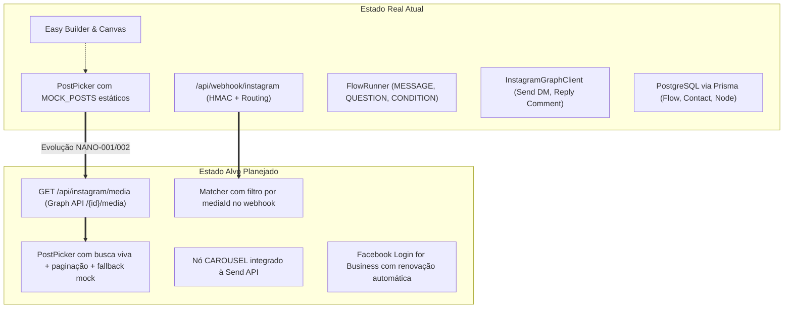

# ARCHITECTURE — Arquitetura Técnica do Sistema (Fluxo)

> **Documento:** Especificação Técnica de Arquitetura  
> **Status:** Current State vs Target State  
> **Autor:** Start Inc. / Orquestrador de Execução  

---

## 1. Visão Geral da Stack

| Camada | Tecnologia / Versão | Detalhes |
| :--- | :--- | :--- |
| **Framework Full-Stack** | Next.js 16.3.6 (App Router) | Server Components para SSR e Client Components (`"use client"`) para reatividade |
| **Runtime & Servidor** | Node.js v22+ | Execução nativa com porta fixa `3007` |
| **Linguagem** | TypeScript 5.x | Tipagem estrita ponta a ponta (`strict: true`) |
| **Estilização** | Tailwind CSS v4 + Vanilla CSS | CSS variables para temas Dark/Light e tokens estruturados |
| **Canvas Interativo** | `@xyflow/react` 12.12.0 | Renderização e manipulação do grafo de automação |
| **ORM & Banco** | Prisma 7.10.0 + PostgreSQL | Schema relacional, client gerado via `npx prisma generate` |
| **Validação** | Zod 4.6.5 | Schemas defensivos nas bordas de API e receitas |
| **Testes** | Vitest 5.0.1 | Testes unitários para motor de automação, compilador e regras |

---

## 2. Current State vs Target State

---

## 3. Arquitetura Frontend

### Módulos Principais
1. **Easy Builder (`src/components/simple-builder/`):**
   - `SimpleBuilder.tsx`: Componente mestre que gerencia o estado da receita (`FlowRecipe`).
   - `PostPicker.tsx`: Componente de escolha de post com miniaturas horizontais e modal com grade de 3 colunas.
   - `DmPreview.tsx`: Visualizador de smartphone iPhone/Android que simula o feed, os comentários e o chat de direct com botões clicáveis.
2. **Advanced Flow Canvas (`src/components/flow-editor/`):**
   - Implementado com nós customizados do React Flow (`TriggerNode`, `MessageNode`, `QuestionNode`, `ConditionNode`, `TagNode`, `DelayNode`, `FollowGateNode`).
3. **Navegação & Shell (`src/components/layout/`):**
   - `Sidebar.tsx` e `Topbar.tsx` unificando a navegação entre Dashboard, Fluxos, Contatos, Conversas, Catálogo e Ajustes.

---

## 4. Arquitetura Backend & APIs

### Rotas Existentes
1. `GET /api/webhook/instagram`:
   - Valida desafio da Meta (`hub.mode === 'subscribe' && hub.verify_token === META_VERIFY_TOKEN`).
   - Retorna `hub.challenge` com status 200 em texto plano.
2. `POST /api/webhook/instagram`:
   - Valida assinatura HMAC SHA-256 via header `x-hub-signature-256` e segredo `META_APP_SECRET`.
   - Processa eventos de comentários (`changes.field === 'comments'`), DMs (`messaging.message`) e postbacks (`messaging.postback`).
   - Dispara o `FlowRunner` de forma assíncrona.
3. `GET /api/l/[code]`:
   - Encurtador de links que grava o clique no banco de dados e redireciona o usuário para o destino final via HTTP 302.

### Rotas Alvo (Próxima Implementação)
- `GET /api/instagram/media`:
  - Retorna a lista de publicações recentes (`id`, `caption`, `media_type`, `media_url`, `thumbnail_url`, `permalink`, `timestamp`, `like_count`, `comments_count`) da conta conectada.
  - Implementa fallback defensivo para mock quando sem token ou offline.

---

## 5. Fluxo de Dados e Ciclo de Vida da Execução

1. **Ingresso do Evento:** A Meta envia um POST para o webhook quando um lead comenta em um post.
2. **Verificação de Segurança:** O servidor calcula o HMAC do corpo bruto da requisição e valida a integridade.
3. **Casamento de Gatilho (Matching):**
   - O `Matcher` busca automações ativas com gatilho `COMMENT_KEYWORD`.
   - Verifica se a palavra-chave confere.
   - **(Alvo):** Se o gatilho estiver configurado para `scope: "specific"`, valida se `entry.changes[0].value.media.id === trigger.mediaId`.
4. **Execução de Ações:**
   - Responde ao comentário publicamente via `InstagramGraphClient.replyToComment`.
   - Cria ou atualiza o contato (`Contact`) no banco.
   - Envia DM com o botão de postback via `InstagramGraphClient.sendButtonMessage`.
5. **Transição de Estados:** Quando o lead clica no botão, a Meta emite um evento de `postback` com o ID do próximo nó, avançando a execução do `FlowRun`.

---

## 6. Segurança e Conformidade

- **Tokens e Segredos:** `IG_ACCESS_TOKEN`, `META_APP_SECRET` e `META_VERIFY_TOKEN` nunca são expostos no cliente.
- **Janela de 24h (Meta Policy):** Toda mensagem de saída disparada fora do gatilho imediato deve passar pelo verificador `isWithin24hWindow(lastInboundAt)`.
- **Validação de Inputs:** Todas as entradas de usuário e payloads externos são sanitizados e validados com esquemas Zod.
